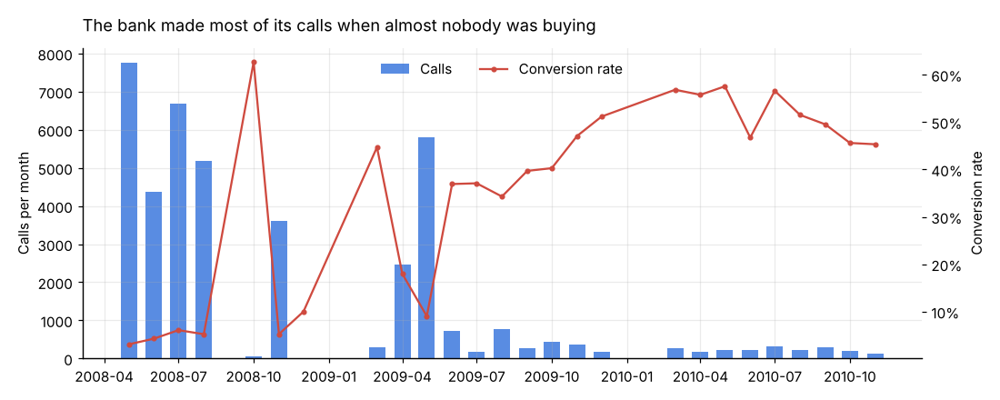
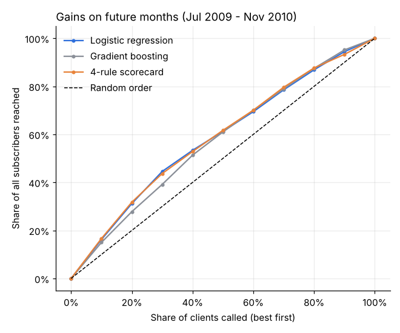

# Bank campaign targeting


A Portuguese bank called 41,188 clients between May 2008 and November 2010 to sell term deposits. 4,640 of them (11.3%) said yes. I wanted to work out who the call center should call first, whether a machine learning model is actually needed for that, and when the calls stop paying for themselves.

The analysis is in [`notebooks/campaign_analysis.ipynb`](notebooks/campaign_analysis.ipynb) (GitHub renders it with all charts). The money side is in an Excel model with live formulas: [`excel/campaign_roi_model.xlsx`](excel/campaign_roi_model.xlsx).

Tools: SQL (DuckDB), Python (pandas, scikit-learn), Jupyter, Excel.



## What I found

**When the bank called mattered more than who it called.** In 2008 it made 27,690 calls, two thirds of the total, and only 4.8% worked. In 2010 it made just 2,058 calls and 52% ended in a sale. Over the same period the 3-month Euribor fell from about 5% to under 1%. I can't separate the two causes (the bank getting pickier vs clients wanting safe deposits after the crash), but timing moved conversion far more than any client attribute did.

**Four patterns held in every year:**

| | 2008 | 2009 | 2010 |
|---|---|---|---|
| Subscribed last campaign vs never contacted | 8.6% vs 4.9% | 57% vs 19% | 77% vs 45% |
| Mobile vs landline | 5.7% vs 3.9% | 20% vs 15% | 58% vs 28% |
| 1-3 calls vs 4+ calls to the same person | 4.9% vs 4.5% | 21% vs 12% | 53% vs 42% |
| Student, retired, under 25 or 60+ vs others | 6.3% vs 4.8% | 33% vs 17% | 55% vs 51% |

**A 4-rule scorecard ranks clients as well as a machine learning model.** I turned those patterns into points (3 for a past subscriber, -1 for a past refusal, +1 for a mobile number, +1 for the student/retired/age group) and compared it with logistic regression and gradient boosting:

| Tested on Jul 2009 - Nov 2010 | AUC | Subscribers reached by calling the top 30% |
|---|---:|---:|
| 4-rule scorecard | 0.665 | 44% |
| Logistic regression | 0.660 | 45% |
| Gradient boosting | 0.642 | 39% |

**A random train/test split would have fooled me.** Gradient boosting scores 0.73 AUC on a random 80/20 split but only 0.64 when trained on the past and tested on later months. Calls from the same month end up on both sides of a random split, so the model partly learns *when* a call happened instead of *who* was called. Call length would push AUC to 0.82, but it's only known after the call, so I left it out.

**In the 2008 mass-calling period, nothing predicted much.** Trained on May-Jul 2008 and tested on Aug-Dec 2008, both the model and the scorecard were no better than random order (AUC 0.47).



**Most calls paid for themselves, so the real question is order.** I assumed a call costs €5 and a new deposit is worth €150 to the bank (€5,000 x 1.5% margin x 2 years). That gives a break-even conversion of 3.3%. Even the weakest 2008 segments converted slightly above that, so almost every call made a little money. Previous subscribers made a lot. These costs aren't in the data, so the Excel model lets you change them.

## Recommendations

1. **Call previous subscribers first, every campaign.** 65% subscribed again, the best of any group in every year.
2. **Rank everyone else with the scorecard.** It ranks as well as the best model, and a call center manager can check every rule.
3. **When agent time is short, cut the 4th and later calls first.** They were 19% of all calls but brought 12% of subscriptions, and they converted worst every year.
4. **Prefer mobile numbers**, and leave landline-only clients for the end of the list.
5. **Test a small sample before a big push.** Monthly conversion ranged from 3% to over 60%. Scale up only if the sample clears break-even.

## Excel model

`excel/campaign_roi_model.xlsx` is built by `excel/build_workbook.py`, and every number in it is a formula:

- **Inputs:** deposit size, margin, years held, cost per call, campaign year, maximum calls per client.
- **By score / By attempt:** calls, subscriptions, revenue, cost, profit and a Call/Skip decision for each segment, plus the highest call cost at which each segment still breaks even.
- **Summary:** calling everyone vs calling only profitable segments within the call limit: calls saved, subscriptions kept, profit difference.
- **Data:** the segment table the notebook exports (`excel/segments.csv`).

## Data quality

| Check | Result | What I did |
|---|---:|---|
| Rows / subscribers | 41,188 / 4,640 | Match the UCI documentation |
| No year column | | Recovered the year from row order. The file is chronological, and March follows December twice (rows 27,691 and 39,131). |
| `pdays = 999` | 39,673 rows | It's a code for "never contacted", not 999 days. Turned into null plus a flag. |
| `unknown` values | job 330, education 1,731, default 8,597 | Kept as their own category |
| Fully duplicated rows | 12 | Kept. Different clients can have the same attributes. |
| Call length | | Excluded from the model because it's only known after the call |

All checks are in [`sql/02_data_quality.sql`](sql/02_data_quality.sql), and the key ones run as tests.

## Project layout

```
data/raw/        bank-additional-full.csv (UCI)
sql/             01 staging, 02 data quality, 03 conversion analysis (DuckDB)
src/campaign/    data loading, model pipelines, scorecard
notebooks/       campaign_analysis.ipynb, the full analysis
excel/           ROI model (xlsx) and the script that builds it
tests/           pytest
docs/            charts
```

## Run it

```bash
pip install -r requirements.txt
pytest
jupyter nbconvert --to notebook --execute --inplace notebooks/campaign_analysis.ipynb
python excel/build_workbook.py
```

The CI workflow runs the same steps on every push, so the notebook and Excel file are always rebuilt from the data.

## Data source

S. Moro, P. Cortez and P. Rita. *A Data-Driven Approach to Predict the Success of Bank Telemarketing.* Decision Support Systems, 62:22-31, 2014. Dataset: [UCI Machine Learning Repository, Bank Marketing](https://archive.ics.uci.edu/dataset/222/bank+marketing) (`bank-additional-full.csv`, CC BY 4.0). The file in `data/raw` is the original 41,188-row version, and its row counts match the UCI documentation.

## Limitations

- One bank, one product, 2008-2010. The scorecard should be checked on new campaign data before anyone uses it.
- Correlation only. Interest rates and the bank's own strategy changed at the same time.
- Costs and deposit value are assumptions, which is why they're inputs in the Excel model.

Kuat Otarbayev
